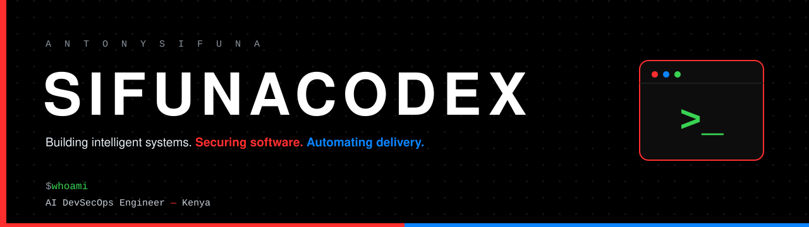
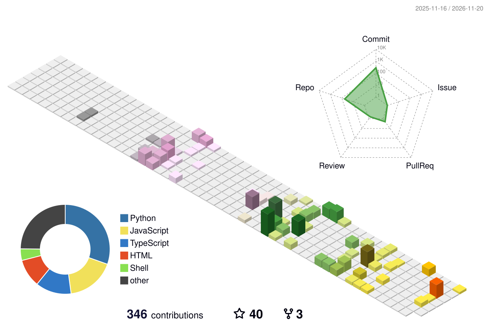

<div align="center">




<a href="https://sifunacodex.top"></a>
<a href="https://github.com/aasz253"></a>
<a href="https://linkedin.com/in/sifuna-codex-3238203b4"></a>
<a href="mailto:antonysifuna07@gmail.com"></a>
<a href="https://wa.me/254723915661"></a>


</div>

---

## About

I'm **Antony Sifuna** — **SifunaCodex**. I build AI-driven systems and the engineering platform around them: LLM applications and RAG pipelines, secure APIs, and the CI/CD and security automation that ship them safely.

My work spans **AI engineering**, **software engineering**, **application security** and **cloud-native infrastructure** — Python/FastAPI backends, React/Next.js frontends, Docker and GitHub Actions pipelines with security scanning built in. I focus on practical, production-oriented systems: software that is deployed, monitored, and defensible, not just demos.

- Building LLM applications — RAG assistants, agents, grounded generation with source citations
- Integrating security into delivery — SAST, dependency scanning, container hardening, least-privilege access
- Shipping in the open — public repositories at [github.com/aasz253](https://github.com/aasz253)

## Engineering Specializations

| Domain | Focus |
| :-- | :-- |
| **AI Engineering** | Python · LLM Applications · RAG · LangChain · AI Agents · OpenAI APIs · Hugging Face · Vector Databases · Prompt Engineering · AI Application Security |
| **Software Engineering** | Python · JavaScript · TypeScript · Java · C++ · React · Next.js · Node.js · FastAPI · Django · REST APIs |
| **DevSecOps** | Docker · Kubernetes · GitHub Actions · CI/CD · Terraform · Linux · Automated Testing · Security Scanning · Deployment Automation |
| **Cybersecurity** | OWASP · Application Security · SAST · Dependency Security · Vulnerability Assessment · Secure Authentication · API Security · AI Security |
| **Cloud & Infrastructure** | AWS · Linux · Nginx · Containerization · Cloud Infrastructure · Infrastructure Automation |
| **Databases** | PostgreSQL · MongoDB · MySQL · Redis |

These are the stacks I work with in shipped projects — see the repositories below for proof of work.

<div align="center">


</div>

## Featured Projects

| Project | What it does | Stack | Live |
| :-- | :-- | :-- | :-- |
| [**AI Knowledge Assistant**](https://github.com/aasz253/AI-Knowledge-Assistant) | Production-grade RAG assistant — grounded answers from private documents with source citations, prompt-injection defense, streaming, 35 tests, CI with Ruff/Bandit/pip-audit/Trivy | Python · FastAPI · FAISS · OpenAI · React | [Demo](https://ai-knowledge-assistant-puce.vercel.app/) |
| [**ZeroTrust Hub**](https://github.com/aasz253/ZeroTrust-Hub-) | AI-powered SOC dashboard — threat monitoring, vulnerability scanning, malware analysis, JWT auth, real-time WebSocket updates | FastAPI · React 19 · TypeScript · PostgreSQL · Redis · Celery | [Demo](https://zerotrust-hub.vercel.app) |
| [**ReminderBot Pro**](https://github.com/aasz253/ReminderBot-Pro) | Smart reminder SaaS — email/SMS/push notifications, natural-language scheduling, Stripe billing, Terraform-managed infra | Python · FastAPI · Next.js · PostgreSQL · Stripe · Terraform | — |
| [**Sentinel IDS**](https://github.com/aasz253/CodeAlpha_Sentinel-IDS) | Web-based network intrusion detection on top of Snort — real-time alert parsing, classification, email/Telegram notifications | Python · Flask · Snort · SQLite · Chart.js | — |
| [**CYBERSTRIKE: The African Hacker**](https://github.com/aasz253/cyberstrile) | Interactive cybersecurity training game — 15 missions across 5 chapters: phishing analysis, SIEM, incident response, network defense | TypeScript · HTML/CSS | [Demo](https://cyberstrike-lyart.vercel.app) |
| [**SifunaCloud File API**](https://github.com/aasz253/SifunaCloud-File-API) | Secure file-upload service on AWS EC2 (Ubuntu) streaming to S3 with an IAM role — cloud file ingestion without long-lived credentials | Python · FastAPI · AWS EC2 · S3 · IAM | — |

More work on my [repositories page](https://github.com/aasz253?tab=repositories).

## Engineering Philosophy

Security is integrated throughout the lifecycle — not bolted on at the end:

```text
PLAN → DEVELOP → TEST → SCAN → SECURE → BUILD → DEPLOY → MONITOR
```

- **Shift left** — security requirements and threat modeling at design time
- **Automate enforcement** — SAST, dependency and container scanning in CI, failing builds on critical findings
- **Least privilege** — scoped IAM roles, short-lived tokens, no secrets in code
- **Verify in production** — monitoring, alerting and feedback into the next cycle

### AI Security

| Layer | Practice |
| :-- | :-- |
| **Prompt injection** | Untrusted content (documents, user input) is data, never instructions |
| **Secure RAG** | Retrieval grounding, output constraints, source citations, refusal when unsupported |
| **Data leakage** | Access-scoped retrieval, output validation and redaction before display |
| **API authentication** | JWT/OAuth2, scoped tokens, rate limiting, audit logging |
| **Model security** | Vetted model sources, pinned dependencies, scanned images |
| **Supply chain** | Dependency pinning, automated vulnerability scanning in CI |
| **Input/output validation** | Schema validation at every boundary — requests and responses |

## GitHub Analytics

<div align="center">


<br/>


</div>

### 3D Contribution Graph

<div align="center">

</div>

### Contribution Snake

<picture>
  <source media="(prefers-color-scheme: dark)" srcset="https://raw.githubusercontent.com/aasz253/aasz253/output/github-contribution-grid-snake-dark.svg" />
  
</picture>

## Education

**Masinde Muliro University of Science and Technology (MMUST)**
B.Sc. Computer Science — 2024–2027 (in progress)

## Current Focus

- **AI Engineering & LLM applications** — RAG systems, agents, evaluations
- **LLMOps & AI Security** — prompt-injection defense, secure deployment
- **Production-grade RAG** — grounded, cited, tested
- **Kubernetes & cloud-native infrastructure**
- **DevSecOps automation** — CI/CD with integrated security scanning
- **Open-source engineering** — building and sharing in public

## Connect & Collaborate

Open to **AI engineering**, **DevSecOps** and **software engineering** opportunities — including remote and international roles — plus collaborations, open-source projects and technical consulting.

<div align="center">

[](https://sifunacodex.top)
[](https://github.com/aasz253)
[](https://linkedin.com/in/sifuna-codex-3238203b4)
[](mailto:antonysifuna07@gmail.com)
[](https://wa.me/254723915661)

</div>

---

<div align="center">

*Building intelligent systems. Securing software. Automating delivery.*

**SIFUNACODEX**

</div>
